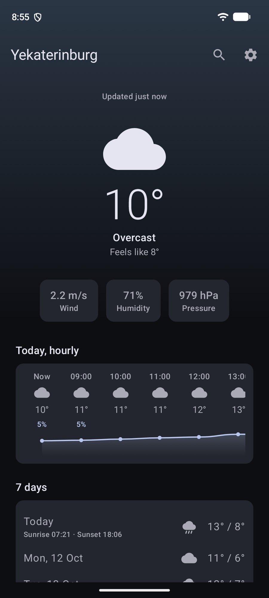
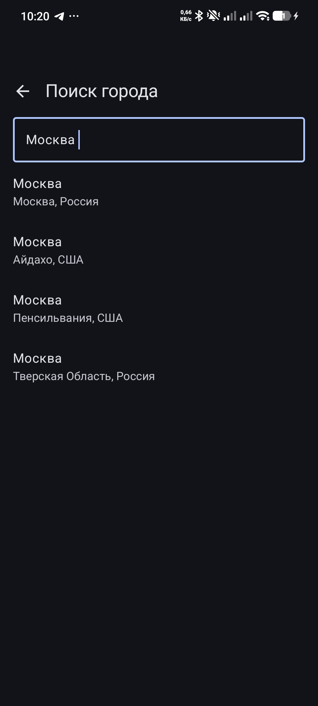
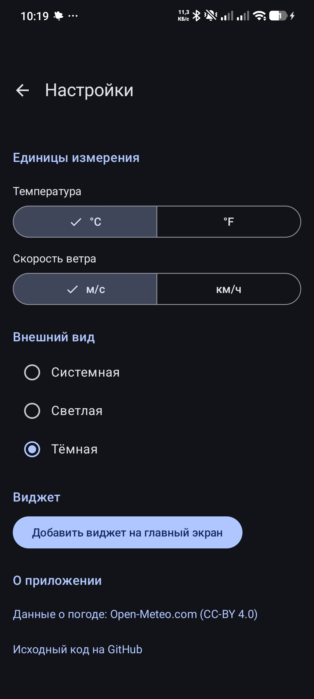
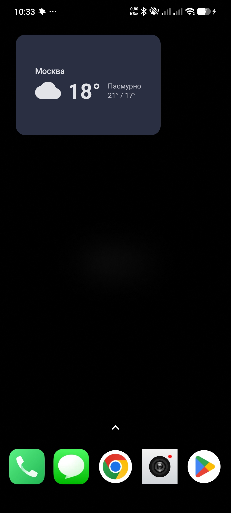
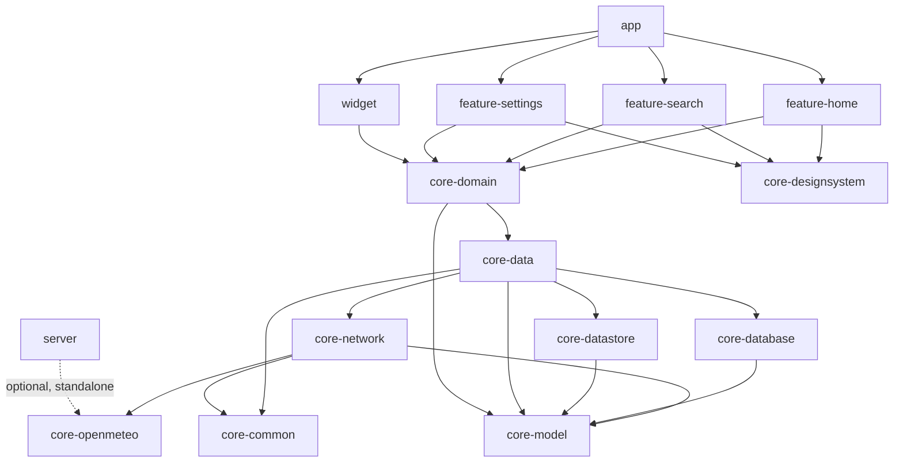

# SkyCast ⛅

**Offline-first Android weather app with a home screen widget.**


<p align="center">
  
  
  
  
</p>

## Features

- 🌤 Current conditions, 24-hour forecast and 7-day forecast with sunrise/sunset
- 🎨 **Weather-aware sky**: the home screen background tints itself by condition and day/night (clear, clouds, rain, snow, storm), animated on change, separate palettes for light and dark theme
- 📈 **Hourly temperature curve** drawn on a Compose `Canvas` (cubic Béziers + gradient fill), scrolling together with the hour columns
- 📡 **Offline-first**: the UI reads only from the local Room cache; the network merely refreshes it — the app works in airplane mode with an honest "updated N min ago" label
- 🔎 City search with debounced geocoding, saved cities, one-tap switching
- 📍 Location detection (coarse, with a graceful fallback to manual search)
- 🌡 Units: °C/°F, m/s / km/h — conversion is done server-side; labels always match the data they were synced with
- 🌓 Light / dark / system theme, Material 3 dynamic color, edge-to-edge
- 📱 **Glance home screen widget** (two responsive sizes) refreshed by WorkManager every 30 min and instantly after every in-app sync; can be pinned right from the app
- 🌐 English and Russian localization
- 🧪 **Optional Ktor proxy/aggregator with Swagger UI** ([`server/`](server), Stage 9, stretch goal) — turns Open-Meteo's raw parallel arrays into a tidy JSON list, with a server-side cache, per-IP rate limiting and a `/swagger` playground; independent of the Android app, see [docs/03-api-swagger.md](docs/03-api-swagger.md)

## Tech stack

| Category | Choice |
|---|---|
| UI | Jetpack Compose · Material 3 · Navigation Compose (type-safe routes) |
| Architecture | Multi-module Clean Architecture (light) · MVVM + UDF |
| DI | Hilt |
| Async | Kotlin Coroutines + Flow |
| Network | Retrofit + OkHttp + kotlinx.serialization |
| Storage | Room (SSOT cache) · Preferences DataStore (settings) |
| Widget | Glance + WorkManager (@HiltWorker) |
| API contract | Hand-written OpenAPI 3 spec ([openapi/weather-api.yaml](openapi/weather-api.yaml)) |
| Quality | detekt + ktlint (maxIssues 0) · ~65 unit tests (JUnit, Turbine, MockWebServer, Robolectric) · GitHub Actions CI |
| Optional backend (Stage 9) | Ktor + Swagger UI, rate limiting, server-side cache — plain JVM module, independent from the Android build |

## Architecture



`server` is not part of the Android app graph — it is a separate, independently deployable Gradle project (see [Tech stack](#tech-stack) above) that shares only the Open-Meteo response contract (`core-openmeteo`) with the app, so both sides can never disagree on that shape.

**Offline-first.** Room is the single source of truth: `WeatherRepository.observeWeather()` returns a `Flow` built from DAO flows (`flatMapLatest` switches the stream when the selected city changes), while `refresh()` only writes to the database — the UI receives new data reactively and never touches the network directly. A failed refresh never corrupts the cache: with data on screen it degrades to a snackbar, without data — to a full-screen error with retry.

**Unidirectional data flow.** Every screen is a stateless `Screen(state, callbacks)` composable driven by a `StateFlow<UiState>` (`combine` of repository flows and UI flags, `stateIn(WhileSubscribed(5_000))`). Screens are trivially previewable and testable.

**Why multi-module?** Enforced layer boundaries (features physically cannot import Retrofit or Room), faster incremental builds, and — honestly — as a learning exercise: for an app this size it is deliberate over-engineering, and the boundaries it enforces are the point.

## Trade-offs & decisions

- **Unit conversion on the server, not the client.** Open-Meteo converts units via query params. Costs a refetch on unit change; buys zero conversion math on the client. The sync-time units are stored next to the cached weather, so labels can never disagree with the numbers — even when the units change offline.
- **Hand-written DTOs, spec as the contract.** The trimmed [OpenAPI spec](openapi/weather-api.yaml) documents exactly the consumed subset of the API (try it in Swagger Editor). Code generation via `openapi-generator` was evaluated; for two endpoints, hand-written DTOs with `@SerialName` won on readability and control.
- **Thin domain layer, honestly.** Most use cases delegate one call. The layer stays because composite scenarios (`DetectMyLocation` = detect → save → select, `UpdateSettings` = write + refresh) need a home, and ViewModels depending on narrow single-purpose classes are easier to read and fake.
- **Fakes over mocks.** Test doubles are hand-written in-memory fakes (`:core:testing`) — they read better than mock DSLs and survive refactorings. MockK was planned and consciously dropped.
- **Preferences DataStore over Proto.** Three settings keys do not justify a proto schema.
- **Hilt pinned at 2.58** — from 2.59 the Gradle plugin requires AGP 9.x; the project stays on the mature AGP 8.13 line.

## Weather data

Weather and geocoding by [Open-Meteo.com](https://open-meteo.com/) (CC-BY 4.0) — free, no API key required, which also means the repository contains no secrets at all. The optional `server/` module (Stage 9) proxies the same Open-Meteo endpoint and repeats the same attribution in its own OpenAPI spec, shown live in its Swagger UI.

## Build & run

```
git clone https://github.com/vihrea1337/skycast.git
```

Open in Android Studio and press **Run** — no API keys or local configuration needed. JDK 17+.

Full checks (what CI runs): `./gradlew detekt lint test assembleDebug`

## Project docs

The complete design docs live in [`docs/`](docs/): [single-file project plan](docs/PLAN.md) (architecture, per-module specs, testing strategy), the [staged roadmap](docs/00-roadmap.md) with acceptance criteria — every stage shipped as a git tag (`v0.1` … `v1.0`) — and [the optional Ktor backend](docs/03-api-swagger.md) (Stage 9: design decisions, how to run it, and a hardening story worth reading).

## License

[MIT](LICENSE)
