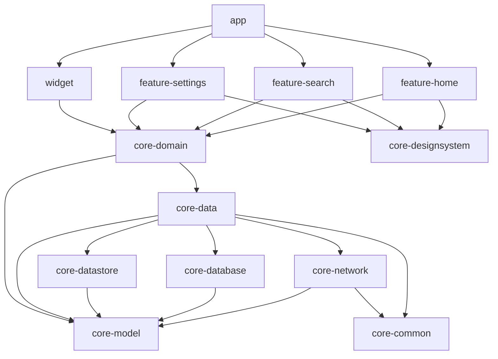

# SkyCast — единый план проекта

> Этот документ объединяет всю проектную документацию в один файл.
> **Этапы работ с чек-листами** — отдельно, в [`00-roadmap.md`](00-roadmap.md).
> Исходные подокументы (по одному на модуль) сохранены в `archive/docs-sources-2026-07-08.zip`.

**Проект:** Android-приложение погоды + виджет домашнего экрана. Пет-проект для портфолио уровня middle-junior.
**Стек:** Kotlin · Jetpack Compose · Glance · Hilt · Retrofit + kotlinx.serialization · Room · DataStore · WorkManager · Open-Meteo API · OpenAPI/Swagger · GitHub Actions.

## Оглавление

1. [О проекте в двух словах](#1-о-проекте-в-двух-словах)
2. [Архитектура](#2-архитектура)
3. [Технологический стек](#3-технологический-стек)
4. [REST API и Swagger](#4-rest-api-и-swagger)
5. [Модули](#5-модули) — app · common · model · network · database · datastore · data · domain · designsystem · home · search · settings · widget
6. [Тестирование](#6-тестирование)
7. [CI/CD и качество кода](#7-cicd-и-качество-кода)
8. [Оформление для портфолио](#8-оформление-для-портфолио)

---

# 1. О проекте в двух словах

Приложение показывает текущую погоду, почасовой прогноз на сутки и прогноз на 7 дней для выбранного города. Город ищется по названию или определяется по геолокации. Работает без интернета (показывает последние загруженные данные), настраиваются единицы измерения и тема. На домашний экран ставится виджет, который сам обновляется в фоне.

Главные «взрослые» черты проекта, ради которых всё затевается:

- **Offline-first** — приложение живёт от локальной базы, сеть лишь пополняет её;
- **многомодульность** — 13 Gradle-модулей с жёсткими правилами зависимостей;
- **виджет на Glance + WorkManager** — то, чего нет у большинства джуниорских пет-проектов;
- **работа с OpenAPI/Swagger** — свой контракт API и опыт кодогенерации;
- **тесты и CI** — зелёный бейдж GitHub Actions, страховка ключевой логики.

---

# 2. Архитектура

## 2.1 Принципы

1. **Clean Architecture light** — три слоя: data → domain → presentation. «Light», потому что без фанатизма: domain-слой тонкий, без отдельных domain-интерфейсов на каждый чих.
2. **UDF (Unidirectional Data Flow)** — состояние течёт вниз (`StateFlow<UiState>` из ViewModel в Compose), события вверх (лямбды `onEvent`).
3. **Offline-first** — Room = единственный источник правды (Single Source of Truth). UI **никогда** не читает из сети напрямую; сеть только пополняет БД.
4. **Многомодульность** — по типу (`core`) и по фиче (`feature`). Демонстрирует владение Gradle и ускоряет сборку.

## 2.2 Граф модулей



## 2.3 Правила зависимостей (нарушать нельзя)

| Правило | Зачем |
|---|---|
| `feature` не зависит от `feature` | Навигация между фичами — через `:app` (NavHost) |
| `feature` не видит `core:network` / `core:database` | UI не знает, откуда данные; только repository/use case |
| `core:model` и `core:common` — чистый Kotlin, без Android | Быстрые unit-тесты, честный domain |
| Никаких циклов | Gradle всё равно не даст, но проектировать надо заранее |

## 2.4 Поток данных (пример: экран Home)

```
Compose UI ──collectAsStateWithLifecycle──> HomeViewModel.uiState: StateFlow<HomeUiState>
     │ onRefresh()                              ▲
     ▼                                          │ combine(weather, settings) → UiState
HomeViewModel ──> ObserveWeatherUseCase ──> WeatherRepository
                                                │ observe: Flow из Room DAO   ← SSOT
                                                │ refresh: Retrofit → мапперы → Room.upsert
                                                ▼
                                     (Room обновился → Flow сам эмитит → UI сам перерисовался)
```

Ключевой момент для собеседования: **`refresh()` ничего не возвращает в UI напрямую** (кроме ошибки) — данные приходят реактивно через Flow из БД.

## 2.5 Состояния экрана

```kotlin
sealed interface HomeUiState {
    data object Loading : HomeUiState
    data class Success(val weather: WeatherData, val isRefreshing: Boolean) : HomeUiState
    data class Error(val error: AppError, val cached: WeatherData?) : HomeUiState // ошибка ≠ пустой экран
}
```

В ViewModel: `combine(...).stateIn(viewModelScope, SharingStarted.WhileSubscribed(5_000), Loading)` — стандартный паттерн; знать, почему `5_000` (переживает поворот экрана, но освобождает ресурсы в фоне).

## 2.6 Обработка ошибок

- Единый `AppResult<T>` / `AppError` в `:core:common` (раздел 5.2). Исключения ловятся на границе data-слоя (`safeApiCall`), выше летят только типизированные ошибки.
- UI-правило: если в кэше есть данные — показываем их + snackbar об ошибке; пустой error-экран только когда показывать нечего.

## 2.7 Соглашения

- Пакеты: `com.<ник>.skycast.<модуль>...`; имена файлов = имя главного класса.
- Compose: экран = `XxxScreen(state, onEvent)` (stateless, легко превьюить) + `XxxRoute(viewModel)` (обвязка). Preview на каждый экран/состояние.
- Один Activity (`MainActivity`), диалоги и bottom sheets — тоже Compose.
- Строки только через `strings.xml` (сразу `values/` en + `values-ru/`), никаких хардкодов.

---

# 3. Технологический стек

Версии не фиксируются в доках — берём актуальные стабильные на момент подключения. Требования к окружению: **JDK 17+**, актуальные Android Studio / AGP, Kotlin 2.x (Compose-компилятор — плагин `org.jetbrains.kotlin.plugin.compose`).

## 3.1 SDK

| Параметр | Значение | Почему |
|---|---|---|
| minSdk | 26 (Android 8.0) | ~97% устройств; `java.time` без desugaring |
| targetSdk / compileSdk | последний стабильный | Требование Google Play и хороший тон |

## 3.2 Библиотеки

| Категория | Выбор | Почему именно это (ответ для собеседования) |
|---|---|---|
| UI | Jetpack Compose + Material 3 | Индустриальный стандарт; декларативный UI |
| Навигация | Navigation Compose, type-safe (`@Serializable` routes) | Официальное решение; типобезопасные маршруты вместо строк |
| DI | Hilt | Стандарт для Android; compile-time проверка графа vs Koin (runtime) |
| Асинхронность | Coroutines + Flow | Родное для Kotlin; RxJava — легаси |
| Сеть | Retrofit + OkHttp | Стандарт; декларативные интерфейсы, интерцепторы |
| JSON | kotlinx.serialization | Родная для Kotlin, compile-time, без рефлексии (vs Gson/Moshi) |
| БД | Room | SQLite с compile-time проверкой SQL, отдаёт Flow |
| Настройки | Preferences DataStore | Замена SharedPreferences: асинхронный, Flow, без ANR |
| Виджет | Glance | Compose-синтаксис для RemoteViews |
| Фоновые задачи | WorkManager | Гарантированное выполнение, учёт Doze |
| Геолокация | play-services-location (Fused) | Экономнее и точнее, чем голый LocationManager |
| Splash | AndroidX Core SplashScreen | Единое поведение на всех версиях ОС |
| Тесты | JUnit4, MockK, Turbine, coroutines-test, MockWebServer, Compose UI Test | Раздел 6 |
| Статанализ | detekt + ktlint (плагин detekt-formatting) | Раздел 7 |
| Кодоген API | openapi-generator (Gradle plugin) | Раздел 4 |

## 3.3 Version catalog — скелет `gradle/libs.versions.toml`

```toml
[versions]
# agp, kotlin, ksp, compose-bom, hilt, retrofit, room, ... — актуальные стабильные

[libraries]
# имена в kebab-case: retrofit-core, retrofit-kotlinx-serialization, okhttp-logging,
# room-runtime, room-ktx, room-compiler, hilt-android, hilt-compiler, ...

[bundles]
# bundles.room = ["room-runtime", "room-ktx"], bundles.retrofit = [...]

[plugins]
android-application = { id = "com.android.application", version.ref = "agp" }
android-library = { id = "com.android.library", version.ref = "agp" }
kotlin-android = { id = "org.jetbrains.kotlin.android", version.ref = "kotlin" }
kotlin-compose = { id = "org.jetbrains.kotlin.plugin.compose", version.ref = "kotlin" }
kotlin-serialization = { id = "org.jetbrains.kotlin.plugin.serialization", version.ref = "kotlin" }
ksp = { id = "com.google.devtools.ksp", version.ref = "ksp" }
hilt = { id = "com.google.dagger.hilt.android", version.ref = "hilt" }
```

## 3.4 Подводные камни

- **KSP, не kapt** — для Room и Hilt (kapt медленный и в режиме поддержки).
- Compose BOM управляет версиями всех compose-артефактов — версии у отдельных compose-библиотек не указывать.
- `kotlinx-serialization` + Retrofit требует конвертер `retrofit2-kotlinx-serialization-converter` и `MediaType "application/json"`.
- В каждом модуле — `namespace` и одинаковые compileOptions/jvmTarget; на этапе 1 можно вынести в convention plugin (`build-logic/`), но для junior-mid проекта допустимо копировать.

---

# 4. REST API и Swagger

## 4.1 Выбор API: Open-Meteo

**Почему Open-Meteo, а не OpenWeatherMap:** бесплатно и **без API-ключа** (нечего прятать в репозитории — для публичного портфолио большой плюс), честный REST + JSON, есть **официальная OpenAPI-спецификация** (то, что нужно для Swagger-практики), лицензия CC-BY 4.0 (нужна атрибуция в «О приложении»).

Два сервиса, оба без авторизации.

### Прогноз — `GET https://api.open-meteo.com/v1/forecast`

Пример (Сургут):

```
/v1/forecast?latitude=61.25&longitude=73.39
  &current=temperature_2m,apparent_temperature,relative_humidity_2m,weather_code,wind_speed_10m,surface_pressure,is_day
  &hourly=temperature_2m,weather_code,precipitation_probability
  &daily=weather_code,temperature_2m_max,temperature_2m_min,sunrise,sunset
  &timezone=auto&forecast_days=7
  &temperature_unit=celsius&wind_speed_unit=ms        ← единицы прокидываем из настроек
```

Ответ (сокращённо) — hourly/daily это **параллельные массивы**, а не массив объектов:

```json
{
  "current": { "time": "2026-07-08T14:00", "temperature_2m": 21.4, "weather_code": 3, "wind_speed_10m": 4.2, "is_day": 1 },
  "hourly":  { "time": ["2026-07-08T00:00", "..."], "temperature_2m": [17.1], "weather_code": [2] },
  "daily":   { "time": ["2026-07-08"], "temperature_2m_max": [22.5], "sunrise": ["2026-07-08T02:57"] }
}
```

Маппер в `:core:data` «сшивает» параллельные массивы в список объектов — хорошая задача на unit-тест.

### Геокодинг — `GET https://geocoding-api.open-meteo.com/v1/search`

```
/v1/search?name=Сургут&count=5&language=ru
→ { "results": [ { "id": 1490624, "name": "Сургут", "latitude": 61.25, "longitude": 73.39,
                   "country": "Россия", "admin1": "ХМАО" } ] }
```

⚠️ При пустом результате поле `results` **отсутствует** в JSON — DTO должно иметь `val results: List<...> = emptyList()`.

### Коды погоды (WMO weather_code)

API отдаёт число — маппим в enum `WeatherType` (иконка + строковый ресурс): 0 ясно; 1–3 облачно; 45,48 туман; 51–57 морось; 61–67 дождь; 71–77 снег; 80–82 ливень; 85–86 снегопад; 95–99 гроза. Маппинг — чистая функция, покрыть тестом.

## 4.2 План работы со Swagger (по нарастающей)

1. **Изучение (этап 2):** открыть editor.swagger.io, вставить официальную спеку Open-Meteo (`openapi.yml` в их GitHub-репозитории `open-meteo/open-meteo`), поизучать схемы, погонять запросы через «Try it out».
2. **Своя спека (этап 2):** написать руками урезанную `openapi/weather-api.yaml` **только под используемые поля** (два path, схемы ответов). Главное учебное упражнение: понять структуру OpenAPI 3 (paths, parameters, components/schemas, $ref). Файл лежит в репозитории — «контракт» проекта.
3. **Кодогенерация (этап 2, ветка-эксперимент):** Gradle-плагин `org.openapi.generator` генерирует DTO из своей спеки:

```kotlin
// build.gradle.kts модуля :core:network
openApiGenerate {
    generatorName.set("kotlin")
    inputSpec.set("$rootDir/openapi/weather-api.yaml")
    outputDir.set(layout.buildDirectory.dir("generated/openapi").get().asPath)
    configOptions.set(mapOf(
        "library" to "jvm-retrofit2",
        "serializationLibrary" to "kotlinx_serialization",
        "useCoroutines" to "true",
    ))
}
// + добавить сгенерированные исходники в sourceSets и повесить задачу перед compile
```

   Сравнить сгенерированное с рукописным и **осознанно выбрать**. Рекомендация: в main оставить рукописные DTO (их мало, полный контроль), спеку хранить как документацию, опыт кодогена описать в README. Честный trade-off — отличная история для собеседования.
4. **Свой Swagger UI (этап 9, опционально):** мини-бэкенд на **Ktor** — прокси/агрегатор Open-Meteo (`GET /api/v1/weather?lat&lon` — один аккуратный JSON вместо параллельных массивов, кэш на стороне сервера). Документация через OpenAPI-плагин Ktor + Swagger UI на `/swagger`. Деплой не обязателен — достаточно `docker compose up` и скриншота Swagger UI в README.

## 4.3 Контракт сетевого слоя

- Таймауты OkHttp: connect/read 10 с. Ретраев не делаем (WorkManager и pull-to-refresh покрывают).
- Все вызовы через `safeApiCall { ... }` → `AppResult`: IOException → `AppError.Network`, HTTP != 2xx → `AppError.Server(code)`, SerializationException → `AppError.Unknown` (+ лог — значит, контракт разошёлся).
- `HttpLoggingInterceptor` — уровень BODY только в debug-сборке.

---

# 5. Модули

Обзор одной строкой — «что это, простыми словами»:

| Модуль | Простыми словами |
|---|---|
| `:app` | Точка сборки: Application, MainActivity, NavHost, манифест |
| `:core:common` | Базовые типы: результат/ошибки, инжект диспетчеров |
| `:core:model` | Доменные модели — общий язык всех слоёв |
| `:core:network` | Всё общение с интернетом (Retrofit, DTO) |
| `:core:database` | Локальный кэш на Room — источник правды |
| `:core:datastore` | Настройки пользователя (DataStore) |
| `:core:data` | Репозитории: склеивают сеть + БД + настройки, мапперы |
| `:core:domain` | Use cases — сценарии поверх репозиториев |
| `:core:designsystem` | Тема, иконки погоды, переиспользуемые компоненты |
| `:feature:home` | Главный экран: текущая погода + прогнозы |
| `:feature:search` | Поиск города, сохранённые города, геолокация |
| `:feature:settings` | Единицы измерения, тема, «О приложении» |
| `:widget` | Виджет домашнего экрана (Glance + WorkManager) |

## 5.1 `:app`

**Роль:** точка сборки. Единственный модуль с плагином `com.android.application`. Кода минимум — только «клей».
**Зависимости:** все `:feature:*`, `:widget`, `:core:designsystem`, `:core:data` (только чтобы Hilt увидел биндинги data-слоя).

Состав: `SkyCastApplication` (@HiltAndroidApp + конфиг WorkManager с HiltWorkerFactory), `MainActivity` (@AndroidEntryPoint, single activity, `enableEdgeToEdge()`, `installSplashScreen()`), `navigation/SkyCastNavHost.kt`.

Навигация — фичи не знают друг о друге, только колбэки, которые `:app` превращает в navigate:

```kotlin
NavHost(navController, startDestination = HomeRoute) {
    homeScreen(onSearchClick = { navController.navigate(SearchRoute) },
               onSettingsClick = { navController.navigate(SettingsRoute) })
    searchScreen(onBack = navController::popBackStack)
    settingsScreen(onBack = navController::popBackStack)
}
```

Манифест: `INTERNET`, `ACCESS_COARSE_LOCATION` (fine не нужен — для погоды хватает города); receiver виджета регистрируется в `:widget` (манифесты мёржатся).

Сборка: `debug` (суффикс `.debug`) и `release` (`isMinifyEnabled`, `isShrinkResources`, proguard). ⚠️ После включения R8 прогнать release руками: kotlinx.serialization и Retrofit требуют consumer-правил. Подпись: keystore локально + `keystore.properties` в `.gitignore`.

**Готово, когда:** старт < 2 с без «двойной заставки»; back-stack корректен; release-сборка с R8 работает на устройстве.

## 5.2 `:core:common`

**Роль:** фундаментальные типы, нужные всем. Чистый Kotlin (`kotlin("jvm")`), зависимость — только kotlinx-coroutines-core. Модуль должен быть маленьким и стабильным (каждое изменение перекомпилирует полдерева).

```kotlin
sealed interface AppResult<out T> {
    data class Success<T>(val data: T) : AppResult<T>
    data class Failure(val error: AppError) : AppResult<Nothing>
}

sealed interface AppError {
    data object Network : AppError                 // IOException — нет сети/таймаут
    data class Server(val code: Int) : AppError    // HTTP 4xx/5xx
    data object Unknown : AppError                 // всё остальное (включая ошибки парсинга)
}
```

Почему не встроенный `kotlin.Result`: он не типизирует ошибку (Throwable), а UI должен различать «нет сети» и «сервер упал» без instanceof-каскадов.

Диспетчеры через DI (обязательно для тестируемости): `@Qualifier annotation class Dispatcher(val type: DispatcherType)`; правило — **никогда** не писать `Dispatchers.IO` напрямую вне этого модуля (в тестах подменяется на `StandardTestDispatcher`; соблюдение проверяется detekt-правилом ForbiddenImport).

**Готово, когда:** модуль собирается как JVM без Android; `Dispatchers.IO` нигде не встречается напрямую.

## 5.3 `:core:model`

**Роль:** доменные модели — общий язык слоёв. Чистый Kotlin, без зависимостей (`java.time` доступен при minSdk 26).

Это **не** DTO и **не** Room-entities: у сети и БД свои классы, сюда они **маппятся**. Тройное дублирование — осознанное: контракт API, схема БД и доменная модель меняются по разным причинам (Single Responsibility).

```kotlin
data class Location(val id: Long, val name: String, val region: String?,   // admin1: «ХМАО»
                    val country: String, val latitude: Double, val longitude: Double)

data class WeatherData(              // агрегат: всё для Home-экрана и виджета
    val location: Location,
    val current: CurrentWeather,
    val hourly: List<HourlyForecast>,   // ближайшие 24 ч
    val daily: List<DailyForecast>,     // 7 дней
    val updatedAt: Instant,             // «обновлено N мин назад» + политика устаревания
)

data class CurrentWeather(val temperature: Double, val feelsLike: Double,
    val humidityPercent: Int, val pressureHpa: Double, val windSpeed: Double,
    val weatherType: WeatherType, val isDay: Boolean)

data class HourlyForecast(val time: LocalDateTime, val temperature: Double,
                          val weatherType: WeatherType, val precipitationProbability: Int)

data class DailyForecast(val date: LocalDate, val tempMin: Double, val tempMax: Double,
                         val weatherType: WeatherType, val sunrise: LocalDateTime, val sunset: LocalDateTime)

enum class WeatherType { CLEAR, PARTLY_CLOUDY, OVERCAST, FOG, DRIZZLE, RAIN, SNOW,
                         RAIN_SHOWERS, SNOW_SHOWERS, THUNDERSTORM;
    companion object { fun fromWmoCode(code: Int): WeatherType = TODO() } // единственная логика в модуле
}

enum class TemperatureUnit { CELSIUS, FAHRENHEIT }
enum class WindSpeedUnit { METERS_PER_SECOND, KILOMETERS_PER_HOUR }
enum class ThemeMode { SYSTEM, LIGHT, DARK }
data class UserSettings(val temperatureUnit: TemperatureUnit, val windSpeedUnit: WindSpeedUnit, val theme: ThemeMode)
```

Тонкости: температуры — `Double`, округление только в UI; время — `LocalDateTime` (API отдаёт локальное время точки при `timezone=auto`), `updatedAt` — `Instant` (момент синка), не путать; никакого форматирования в моделях.

**Готово, когда:** `fromWmoCode` покрыт тестом на все группы кодов; в модуле нет import android/retrofit/room.

## 5.4 `:core:network`

**Роль:** всё общение с интернетом. Наружу — интерфейс `NetworkDataSource` и DTO; Retrofit/OkHttp наружу не торчат (`implementation`, не `api`).
**Зависимости:** `:core:common`, `:core:model`; retrofit, okhttp, kotlinx-serialization + конвертер.

Состав: `ForecastApi` и `GeocodingApi` (⚠️ два разных baseUrl → **два Retrofit-инстанса**, Hilt-квалификаторы); DTO с `@SerialName("temperature_2m")` и `val results: List<PlaceDto> = emptyList()`; `NetworkDataSource` + `RetrofitNetworkDataSource`; `di/NetworkModule` (OkHttp: таймауты 10 с, logging в debug; `Json { ignoreUnknownKeys = true }`).

```kotlin
interface ForecastApi {
    @GET("v1/forecast")
    suspend fun getForecast(
        @Query("latitude") lat: Double, @Query("longitude") lon: Double,
        @Query("current") current: String = CURRENT_PARAMS,   // константы со списками полей
        @Query("hourly") hourly: String = HOURLY_PARAMS,
        @Query("daily") daily: String = DAILY_PARAMS,
        @Query("timezone") tz: String = "auto",
        @Query("forecast_days") days: Int = 7,
        @Query("temperature_unit") tempUnit: String,          // из настроек
        @Query("wind_speed_unit") windUnit: String,
    ): ForecastResponseDto
}

suspend fun <T> safeApiCall(block: suspend () -> T): AppResult<T> = try {
    AppResult.Success(block())
} catch (e: IOException) { AppResult.Failure(AppError.Network) }
  catch (e: HttpException) { AppResult.Failure(AppError.Server(e.code())) }
  catch (e: CancellationException) { throw e }   // ⚠️ корутинную отмену НЕ глотать — классическая ошибка
  catch (e: Exception) { AppResult.Failure(AppError.Unknown) }
```

Решение по единицам: единицы (°C/°F, м/с) передаём **параметрами запроса** — конвертирует сервер. Trade-off: смена единиц требует нового запроса, зато нет своей математики. Альтернатива (хранить в СИ, конвертировать в UI) тоже валидна; выбор зафиксировать в README.

Тесты (MockWebServer): парсинг реального сэмпла (JSON в `src/test/resources`); отсутствующий `results` → пустой список; HTTP 500 → `AppError.Server`; обрыв → `AppError.Network`; неизвестные поля игнорируются.

**Готово, когда:** типы Retrofit/OkHttp не видны за пределами модуля; тесты зелёные; логирование тел выключено в release.

## 5.5 `:core:database`

**Роль:** локальный кэш (Room) — единственный источник правды для UI. Наружу — DAO и entities; сам `RoomDatabase` не торчит.

Схема:

```
LocationEntity(id PK, name, region, country, latitude, longitude,
               isSelected: Boolean, sortOrder: Int)          // ровно один isSelected
CurrentWeatherEntity(locationId PK → FK Location(CASCADE), temperature, feelsLike,
               humidity, pressure, windSpeed, wmoCode, isDay, updatedAtEpochSec)
HourlyForecastEntity(id PK autogen, locationId FK(CASCADE) + index, time, temperature, wmoCode, precipProb)
DailyForecastEntity(id PK autogen, locationId FK(CASCADE) + index, date, tempMin, tempMax, wmoCode, sunrise, sunset)
```

Время: epoch seconds (`Long`) — без TypeConverter-магии; даты часов/дней — ISO-строки от API как есть (парсит маппер в `:core:data`).

```kotlin
@Dao interface WeatherDao {
    @Query("SELECT * FROM current_weather WHERE locationId = :locationId")
    fun observeCurrent(locationId: Long): Flow<CurrentWeatherEntity?>   // nullable! кэша может не быть

    @Transaction  // прогноз заменяем атомарно: delete + insert одним махом
    suspend fun replaceForecast(locationId: Long, current: CurrentWeatherEntity,
                                hourly: List<HourlyForecastEntity>, daily: List<DailyForecastEntity>)
}

@Dao interface LocationDao {
    @Query("SELECT * FROM locations ORDER BY sortOrder") fun observeAll(): Flow<List<LocationEntity>>
    @Query("SELECT * FROM locations WHERE isSelected = 1") fun observeSelected(): Flow<LocationEntity?>
    @Transaction suspend fun select(id: Long)  // снять старый isSelected, поставить новый — атомарно
}
```

Тонкости: DAO-методы с `Flow` — **не** suspend; Flow из Room эмитит при любом изменении таблицы (реактивность бесплатно); миграции — пока схема пляшет, `fallbackToDestructiveMigration()` + `exportSchema = false`, перед `v1.0` включить `exportSchema = true`, папку `schemas/` в git и писать настоящие миграции (отметить в README — хорошо смотрится на собеседовании); FK + CASCADE: удаление города чистит его прогнозы.

Тесты (in-memory database): атомарность replaceForecast; эксклюзивность isSelected; CASCADE.

**Готово, когда:** UI-слой не импортирует entities (их видит только `:core:data`); тесты DAO зелёные.

## 5.6 `:core:datastore`

**Роль:** настройки через Preferences DataStore. Маленький модуль — и это нормально.

```kotlin
class SettingsDataSource @Inject constructor(private val dataStore: DataStore<Preferences>) {
    private object Keys {
        val TEMP_UNIT = stringPreferencesKey("temperature_unit")
        val WIND_UNIT = stringPreferencesKey("wind_speed_unit")
        val THEME = stringPreferencesKey("theme_mode")
    }

    val settings: Flow<UserSettings> = dataStore.data
        .catch { if (it is IOException) emit(emptyPreferences()) else throw it }  // ⚠️ повреждённый файл ≠ крэш
        .map { prefs -> UserSettings(
            temperatureUnit = prefs[Keys.TEMP_UNIT].toEnumOrDefault(TemperatureUnit.CELSIUS),
            windSpeedUnit = prefs[Keys.WIND_UNIT].toEnumOrDefault(WindSpeedUnit.METERS_PER_SECOND),
            theme = prefs[Keys.THEME].toEnumOrDefault(ThemeMode.SYSTEM),
        ) }

    suspend fun setTemperatureUnit(unit: TemperatureUnit) { dataStore.edit { it[Keys.TEMP_UNIT] = unit.name } }
}
```

Hilt: `PreferenceDataStoreFactory.create(...)`, **@Singleton обязательно** — два инстанса DataStore на один файл = `IllegalStateException` в рантайме.

Тонкости: enum храним строкой `name` + безопасный парс с дефолтом; выбранный город здесь **не** храним — он в Room (`isSelected`): это данные, а не настройка. Preferences, а не Proto: для 3 ключей прото-схема — овер (сказать на собеседовании — плюс).

**Готово, когда:** настройки переживают перезапуск; смена значения реактивно видна на всех экранах.

## 5.7 `:core:data`

**Роль:** сердце data-слоя. Репозитории объединяют сеть + БД + датастор в offline-first API; здесь же все мапперы DTO → Entity → модель.
**Зависимости:** network, database, datastore, model, common; play-services-location.

```kotlin
interface WeatherRepository {
    fun observeWeather(): Flow<WeatherData?>       // SSOT: только из Room; null — кэша ещё нет
    suspend fun refresh(): AppResult<Unit>         // сеть → Room; данные придут через observe
}

interface LocationRepository {
    fun observeSavedLocations(): Flow<List<Location>>
    fun observeSelected(): Flow<Location?>
    suspend fun search(query: String): AppResult<List<Location>>   // geocoding, БЕЗ сохранения
    suspend fun save(location: Location)                           // + сразу select
    suspend fun select(id: Long); suspend fun delete(id: Long)
    suspend fun detectCurrent(): AppResult<Location>               // Fused coarse → reverse geocoding
}

interface SettingsRepository {   // тонкая обёртка над SettingsDataSource
    val settings: Flow<UserSettings>
    suspend fun setTemperatureUnit(u: TemperatureUnit); suspend fun setWindSpeedUnit(u: WindSpeedUnit); suspend fun setTheme(t: ThemeMode)
}
```

Ключевая логика `observeWeather()` — самое «архитектурное» место проекта, уметь объяснить:

```kotlin
locationDao.observeSelected().flatMapLatest { selected ->      // смена города переключает поток
    if (selected == null) flowOf(null)
    else combine(weatherDao.observeCurrent(selected.id),
                 weatherDao.observeHourly(selected.id),
                 weatherDao.observeDaily(selected.id)) { c, h, d -> mapToWeatherData(selected, c, h, d) }
}.flowOn(ioDispatcher)
```

`refresh()`: читает selected + единицы → `getForecast(...)` → при ошибке `Failure`, кэш НЕ трогать → успех: мапперы → `replaceForecast(...)` одной транзакцией, `updatedAt = now` → уведомить виджет через интерфейс `WidgetUpdater` (объявлен здесь, реализован в `:widget` — инверсия зависимости). Auto-refresh «старше 30 минут» решает ViewModel по `updatedAt`, репозиторий политику не навязывает.

Мапперы — отдельные файлы-функции, всё под тесты: `ForecastResponseDto.toEntities(locationId)` — сшивка параллельных массивов (главный кандидат на off-by-one); часовой срез — от текущего часа, 24 шт.

Геолокация `detectCurrent()`: только COARSE; permission запрашивает UI; `getCurrentLocation(PRIORITY_BALANCED_POWER_ACCURACY)` (не lastLocation — бывает null/протухшая) → geocoding → ближайший город.

Тесты: fake `NetworkDataSource` + in-memory Room: refresh-успех обновляет БД; refresh-ошибка не трогает кэш; смена selected переключает observeWeather; мапперы на реальных JSON-сэмплах.

**Готово, когда:** UI не видит ни DTO, ни Entity; в авиарежиме observeWeather отдаёт кэш, refresh возвращает `AppError.Network`.

## 5.8 `:core:domain`

**Роль:** use cases — тонкая прослойка между репозиториями и ViewModel. Чистый Kotlin + coroutines.

Честный разговор: для такого размера use cases почти всегда делегируют репозиторию. Слой оставляем: (1) демонстрация Clean Architecture + точка расширения, (2) ViewModel зависят от узких классов, а не «толстого» репозитория. Анти-паттерн, который НЕ делаем: use case + интерфейс + Impl с пустым делегированием. Use case = финальный класс с `operator fun invoke`, без интерфейсов.

```kotlin
// Единственный с реальной логикой — комбинирует погоду и настройки для UI:
class ObserveWeatherUseCase @Inject constructor(
    private val weatherRepo: WeatherRepository,
    private val settingsRepo: SettingsRepository,
) {
    operator fun invoke(): Flow<WeatherWithSettings?> =
        combine(weatherRepo.observeWeather(), settingsRepo.settings) { w, s -> w?.let { WeatherWithSettings(it, s) } }
}
```

Остальные: `RefreshWeatherUseCase` (+ правило «не чаще раза в минуту»), `SearchCityUseCase` (+ trim, минимум 2 символа), `ObserveSavedLocationsUseCase`, `SelectLocationUseCase` (select + refresh), `SaveLocationUseCase` (save + select + refresh), `DeleteLocationUseCase` (+ нельзя удалить последний/выбранный без переназначения selected), `DetectMyLocationUseCase` (detect + save + refresh), `ObserveSettingsUseCase`, `UpdateSettingsUseCase`.

**Композитные сценарии** (Select/Save/DetectMyLocation) — из нескольких вызовов репозиториев — именно они оправдывают слой. Тесты: порядок вызовов (MockK verify), падение на середине сценария (save прошёл, refresh упал → город остаётся, ошибка наверх).

**Готово, когда:** ViewModel не инжектят репозитории напрямую; модуль без Android.

## 5.9 `:core:designsystem`

**Роль:** тема Material 3 + переиспользуемые компоненты + иконки. Зависит только от Compose и `:core:model` (для `WeatherType`). Никаких ViewModel и репозиториев.

- **Тема:** `SkyCastTheme(darkTheme, dynamicColor = true)` — dynamic color на Android 12+, свои схемы как fallback (Material Theme Builder); `themeMode` прокидывается из `:app`. Типографика: системный шрифт + крупный стиль для температуры (`displayLarge` 64sp).
- **Иконки погоды:** `WeatherType` → векторы (Material Symbols или открытые SVG-паки, лицензию в NOTICE), учитывать `isDay` (солнце/луна). Единая точка: `WeatherIcon(type, isDay)` + `WeatherType.labelRes()` («Пасмурно»).
- **Компоненты:** `LoadingContent` (скелетоны), `ErrorContent(error, onRetry)`, `MetricChip(icon, label, value)`, `SkyCastTopBar`, `SectionCard`. Правило: компонент попадает сюда, только если нужен ≥2 фичам; одноразовые блоки живут в своей фиче.
- **Превью — витрина модуля:** на каждый компонент `@PreviewLightDark`. Это и документация, и материал для скриншотов.

Тонкости: contentDescription обязателен (или `null` для декоративных); цвета только из `MaterialTheme.colorScheme` — иначе тёмная тема развалится.

**Готово, когда:** каталог превью не стыден; ни одного `Color(0xFF...)` в feature-модулях.

## 5.10 `:feature:home`

**Роль:** главный экран — текущая погода + почасовой и недельный прогноз.

```kotlin
sealed interface HomeUiState {
    data object Loading : HomeUiState
    data object NoCity : HomeUiState                       // первый запуск: ведём в поиск/геолокацию
    data class Content(val weather: WeatherData, val settings: UserSettings,
                       val isRefreshing: Boolean, val transientError: AppError?) : HomeUiState
    data class Error(val error: AppError) : HomeUiState    // только когда кэша нет вообще
}
```

ViewModel: база — `ObserveWeatherUseCase()` + флаги → `stateIn(WhileSubscribed(5_000), Loading)`; `init` — если `updatedAt` старше 30 мин или кэша нет → `refresh()`; pull-to-refresh — ошибка при живом кэше → `transientError` → snackbar, кэш остаётся. ⚠️ Не хранить `WeatherData` в двух местах: источник — Flow, флаги — отдельный `MutableStateFlow`, соединять `combine`.

Разметка (сверху вниз): TopBar (город → Search, иконки поиска/настроек) → блок текущей погоды (крупная t°, иконка, описание, «ощущается как», «обновлено N мин назад») → метрики `MetricChip` ×3 (ветер/влажность/давление) → «Сегодня по часам» `LazyRow` 24 карточки → «7 дней» (день недели, иконка, min/max, для сегодня — восход/закат). Контейнер: `PullToRefreshBox` + `LazyColumn`.

Форматирование (utils внутри фичи): округление t° до целого со знаком единицы; `DateTimeFormatter` по локали («Сейчас», «15:00», «Ср, 9 июл»); относительное «обновлено N мин назад», > 24 ч — дата + жёлтая пометка устаревания.

Тесты: ViewModel (Turbine + fake use cases): Loading→Content; ошибка без кэша→Error; ошибка с кэшем→Content+transientError; NoCity. Compose-тест: Content рендерит температуру и 24 часовых элемента.

**Готово, когда:** поворот экрана не перезапускает загрузку; первый запуск без города — состояние NoCity с кнопками «Найти город» / «Моё местоположение».

## 5.11 `:feature:search`

**Роль:** поиск города + сохранённые города + «моё местоположение».

Экран: поле поиска (автофокус) → пока пустое: список сохранённых (текущий отмечен, клик = выбрать и назад, свайп = удалить) + кнопка «Использовать моё местоположение» → при вводе: результаты геокодинга «Сургут, ХМАО, Россия», клик = сохранить + выбрать + назад.

Поиск с debounce — эталонная реализация (знать наизусть, почему `debounce` + `distinctUntilChanged` + `mapLatest` — топовый вопрос на собеседованиях):

```kotlin
private val query = MutableStateFlow("")

val searchResults: StateFlow<SearchResultsState> = query
    .debounce(300)
    .distinctUntilChanged()
    .mapLatest { q ->                       // mapLatest: новый ввод отменяет висящий запрос
        if (q.trim().length < 2) SearchResultsState.Idle
        else when (val r = searchCityUseCase(q)) {
            is AppResult.Success -> if (r.data.isEmpty()) SearchResultsState.Empty
                                    else SearchResultsState.Results(r.data)
            is AppResult.Failure -> SearchResultsState.Error(r.error)
        }
    }
    .stateIn(viewModelScope, WhileSubscribed(5_000), SearchResultsState.Idle)
```

Разрешение на геолокацию (весь flow в этой фиче): `rememberLauncherForActivityResult(RequestPermission())` с COARSE → дано: `DetectMyLocationUseCase` (лоадер на кнопке) → успех = назад на Home; отказ → snackbar «Можно выбрать город вручную»; «не спрашивать снова» → snackbar с кнопкой в настройки приложения.

Состояния списка: `Idle` / `Searching` / `Results` / `Empty` / `Error` (с Retry) — свой компонент на каждое, всё превьюится.

Тонкости: удаление выбранного города — selected переезжает на первый (логика в `DeleteLocationUseCase`), последнего — Home в NoCity (оба случая тестом); результаты геокодинга не сохраняются до клика; `language` из `Locale.getDefault().language`.

**Готово, когда:** быстрый набор «сур→сургут» не порождает очередь запросов (видно в логах OkHttp); полный цикл найти→выбрать→удалить работает.

## 5.12 `:feature:settings`

**Роль:** настройки + «О приложении». Самая простая фича — делаем образцово-показательной.

Экран: **Единицы** — температура °C/°F (SegmentedButton), ветер м/с / км/ч; **Внешний вид** — тема системная/светлая/тёмная; **О приложении** — версия, «Данные о погоде: Open-Meteo.com (CC-BY 4.0)» — ссылка, **атрибуция обязательна по лицензии**, ссылка на GitHub, лицензии open-source.

ViewModel — никакого локального стейта-копии: нажали → записали в DataStore → Flow сам вернул → UI обновился (тот же UDF-круг, что и с погодой).

Тонкость — эффект смены единиц: конвертирует **сервер**, поэтому °C→°F требует refresh. Решение: use case после записи в DataStore дёргает `RefreshWeatherUseCase`. Пока сети нет — подписи единиц брать из настроек **на момент синка** (поле `tempUnitAtSync` в БД рядом с погодой), иначе будет «21» с подписью «°F». Тонкий момент — описать решение в README. Смена темы — мгновенная (MainActivity подписана на настройки).

Тесты: смена значения вызывает use case; state отражает DataStore; use case единиц: записал → дёрнул refresh (порядок verify).

**Готово, когда:** настройки переживают перезапуск и мгновенно отражаются на Home; атрибуция Open-Meteo кликабельна.

## 5.13 `:widget`

**Роль:** виджет домашнего экрана на Glance. Гвоздь программы для портфолио — виджеты умеют делать немногие джуниоры.

Состав: `WeatherWidget` (GlanceAppWidget), `WeatherWidgetReceiver` (регистрируется в манифесте **этого** модуля), `WeatherWidgetWorker` (@HiltWorker CoroutineWorker: refresh + updateAll), `AppWidgetUpdater` (реализация `WidgetUpdater` из `:core:data`, @Binds).

Данные: Glance-контент рендерится в RemoteViews — **ViewModel и collectAsState недоступны**. Паттерн:

```kotlin
override suspend fun provideGlance(context: Context, id: GlanceId) {
    // Hilt в GlanceAppWidget не инжектится — зависимости через EntryPoint:
    val repo = EntryPointAccessors.fromApplication(context, WidgetEntryPoint::class.java).weatherRepository()
    val weather = repo.observeWeather().first()   // снапшот из Room — сеть здесь НЕ дёргаем
    provideContent { GlanceTheme { WidgetContent(weather) } }
}
```

Два размера (`SizeMode.Responsive`): компактный ~2×1 (иконка, t°, город) и средний ~4×2 (+ описание, min/max, 3–4 ближайших часа). `GlanceModifier`, `GlanceTheme.colors` — тёмная тема и dynamic color из коробки.

Обновление — два канала:
1. **Периодика:** `PeriodicWorkRequest<WeatherWidgetWorker>(30, MINUTES)` + `enqueueUniquePeriodicWork(KEEP)`, constraint `NetworkType.CONNECTED`; ставится в `onEnabled`, снимается в `onDisabled`; при ошибке сети — `Result.retry()`.
2. **Мгновенно из приложения:** `refresh()` после успеха зовёт `WidgetUpdater.updateAll()` — виджет всегда синхронен приложению.

Поведение: клик — `actionStartActivity<MainActivity>()`; нет данных — заглушка «Открой приложение»; в `xml/weather_widget_info.xml`: `updatePeriodMillis="0"` (обновляет только WorkManager), `previewImage`/`description` для пикера.

Подводные камни: `@HiltWorker` требует `HiltWorkerFactory` в Application и **удаления** дефолтного инициализатора WorkManager из манифеста (`tools:node="remove"`) — забывают все; минимальный интервал PeriodicWork — 15 мин, система сдвигает (Doze) — «обновлено N мин назад» честно это показывает; проверить смену темы системы и ресайз.

**Готово, когда:** виджет живёт сутки на реальном устройстве, данные не старше ~30–40 мин при сети; refresh в приложении мгновенно обновляет виджет; переживает ребут.

---

# 6. Тестирование

Цель — не процент покрытия, а **страховка ключевой логики**: мапперы, репозитории, use cases, ViewModel. UI-тесты — минимальный smoke. Честная стратегия для пет-проекта, её легко защитить на собеседовании.

## 6.1 Инструменты

| Что | Чем | Где |
|---|---|---|
| Unit-тесты | JUnit4 + kotlin.test assertions | все модули, `src/test` |
| Корутины/время | kotlinx-coroutines-test (`runTest`, `StandardTestDispatcher`) | везде, где suspend/Flow |
| Flow-ассеры | Turbine (`flow.test { awaitItem() }`) | ViewModel, репозитории |
| Моки | MockK; в data-слое предпочитать **fake** | use cases, ViewModel |
| Сеть | MockWebServer (OkHttp) | `:core:network` |
| БД | Room in-memory + Robolectric (или androidTest) | `:core:database`, `:core:data` |
| Compose UI | createAndroidComposeRule, semantics | smoke в `:feature:home` |

## 6.2 Что тестируем по модулям

- `:core:model` — `WeatherType.fromWmoCode`: все группы WMO-кодов
- `:core:network` — парсинг реальных JSON-сэмплов, отсутствующее `results`, HTTP 500, обрыв сети
- `:core:database` — атомарность replaceForecast, эксклюзивность isSelected, CASCADE
- `:core:data` — мапперы (сшивка параллельных массивов! пустые массивы, разная длина), refresh-ошибка не портит кэш, flatMapLatest при смене города
- `:core:domain` — композитные сценарии: порядок вызовов, падение на середине
- `:feature:*` — ViewModel через Turbine: переходы состояний, debounce (`advanceTimeBy`), transientError

## 6.3 Паттерны и правила

```kotlin
// Given-When-Then + говорящие имена через backticks:
@Test fun `refresh failure keeps cached weather and exposes transient error`() = runTest { /* ... */ }
```

- **MainDispatcherRule** (подмена `Dispatchers.Main` на тестовый) — общий код в `:core:testing` вместе с fake-репозиториями и сэмплами моделей.
- Fake > Mock для репозиториев: `FakeWeatherRepository` с `MutableStateFlow` читается лучше и не ломается при рефакторинге.
- Один тест — одна причина упасть.
- Тест, который ловил реальный баг, — оставить и подписать комментом. Такие тесты — лучшие.

Smoke UI-тест (один, но показательный): `HomeScreen` с fake-данными — температура, город, 24 элемента hourly, pull-to-refresh дёргает колбэк. Через semantics/testTag.

**Готово, когда (этап 7):** `./gradlew test` зелёный локально и в CI, < 2 мин; поломка любого маппера/контракта DTO валит минимум один тест.

---

# 7. CI/CD и качество кода

## 7.1 Статический анализ (этап 0)

- **detekt** + плагин `detekt-formatting` (внутри — ktlint): один инструмент, две задачи. Конфиг `config/detekt/detekt.yml`.
- Полезные строгие правила: `MagicNumber` (с исключениями для dp/sp), `ForbiddenImport` на `Dispatchers.IO` вне `:core:common`.
- Android Lint: в release-конфиге `abortOnError = true`.

## 7.2 GitHub Actions — `.github/workflows/ci.yml`

```yaml
name: CI
on:
  push: { branches: [main] }
  pull_request:

concurrency:                       # не гонять два CI на одну ветку
  group: ci-${{ github.ref }}
  cancel-in-progress: true

jobs:
  build:
    runs-on: ubuntu-latest
    steps:
      - uses: actions/checkout@v4
      - uses: actions/setup-java@v4
        with: { distribution: temurin, java-version: 17 }
      - uses: gradle/actions/setup-gradle@v4      # кэш Gradle из коробки
      - run: ./gradlew detekt lint testDebugUnitTest assembleDebug --stacktrace
      - uses: actions/upload-artifact@v4
        if: failure()                              # репорты только при падении
        with: { name: reports, path: '**/build/reports/**' }
```

Версии actions проверить при настройке. Instrumentation-тесты в CI не гоняем (эмулятор в Actions медленный) — Room-тесты на Robolectric, чтобы шли как unit.

## 7.3 Release-workflow (этап 8, по тегу)

`on: push: tags: ['v*']` → `assembleRelease` с подписью (keystore в base64 → GitHub Secrets: `KEYSTORE_B64`, `KEYSTORE_PASSWORD`, `KEY_ALIAS`, `KEY_PASSWORD`) → APK к GitHub Release (`softprops/action-gh-release`). Play Store не обязателен для портфолио.

## 7.4 Гигиена репозитория

- Бейдж CI в README; branch protection на `main` (требовать зелёный CI)
- Dependabot/Renovate — приятный бонус, показывает зрелость
- `.gitignore`: `local.properties`, `keystore.properties`, `*.jks`, `build/`, `.idea/`

**Готово, когда:** PR с падающим тестом невозможно смержить; полный CI-прогон < 10 мин.

---

# 8. Оформление для портфолио

Рекрутёр смотрит репозиторий 30–60 секунд: README-шапка → скриншоты → структура. Техлид — 5 минут: архитектура, тесты, история коммитов. Готовим и то, и другое.

## 8.1 README.md проекта (заменит планировочный)

Язык: английский (основной); можно добавить `README.ru.md`. Структура:

1. **Шапка:** название, одна строка сути («Offline-first weather app with home screen widget»), бейджи (CI, Kotlin, API level, License)
2. **Скриншоты:** 3–4 (Home светлая/тёмная, Search, виджет) + GIF с pull-to-refresh или поиском; файлы в `docs/images/`
3. **Features:** 6–8 пунктов
4. **Tech stack:** таблица категория→библиотека
5. **Architecture:** mermaid-диаграмма (GitHub рендерит) + 3–4 абзаца: offline-first, UDF, зачем многомодульность
6. **Trade-offs & decisions** — самый ценный раздел, никто из джунов такое не пишет: конверсия единиц на сервере vs клиенте, рукописные DTO vs openapi-generator, тонкий domain-слой, Preferences vs Proto
7. **API:** Open-Meteo + атрибуция CC-BY 4.0, ссылка на свою `openapi/weather-api.yaml`
8. **Build & run:** два предложения (клонировать, открыть; ключей не нужно — упомянуть, это плюс)

## 8.2 История разработки как артефакт

- Conventional commits, осмысленные сообщения (не «fix», а «fix: keep cached weather on refresh failure»)
- Теги `v0.1`…`v1.0` по этапам; GitHub Release на `v1.0` с APK
- PR-ы самому себе с описанием — покажет умение оформлять изменения (дёшево и полезно)

## 8.3 Вопросы, которые зададут на собеседовании по этому проекту

1. «Почему многомодульность в маленьком приложении?» → скорость инкрементальной сборки, принудительные границы слоёв, демонстрация Gradle; честно: для этого размера — оверинжиниринг в учебных целях
2. «Что такое offline-first и как реализован?» → SSOT в Room, поток данных из раздела 2.4, что при refresh-ошибке
3. «Почему Hilt/kotlinx.serialization/Room?» → колонка «почему» из раздела 3.2
4. «Как работает поиск?» → debounce/distinctUntilChanged/mapLatest наизусть
5. «Как обновляется виджет?» → два канала, ограничения WorkManager, Doze
6. «Что бы ты сделал иначе?» → подготовить честный ответ (например: меньше модулей на старте; скриншот-тесты)

## 8.4 Чек-лист перед публикацией ссылки в резюме

- [ ] CI зелёный, бейдж в README
- [ ] Скриншоты актуальны, GIF < 10 МБ
- [ ] Нет мусора: закомментированного кода, `TODO` без контекста, забытых `Log.d`
- [ ] `git log --oneline` читается как история проекта
- [ ] LICENSE (MIT) и атрибуция Open-Meteo на месте
- [ ] Приложение поставлено с чистого APK на чужой телефон и пережило день использования
